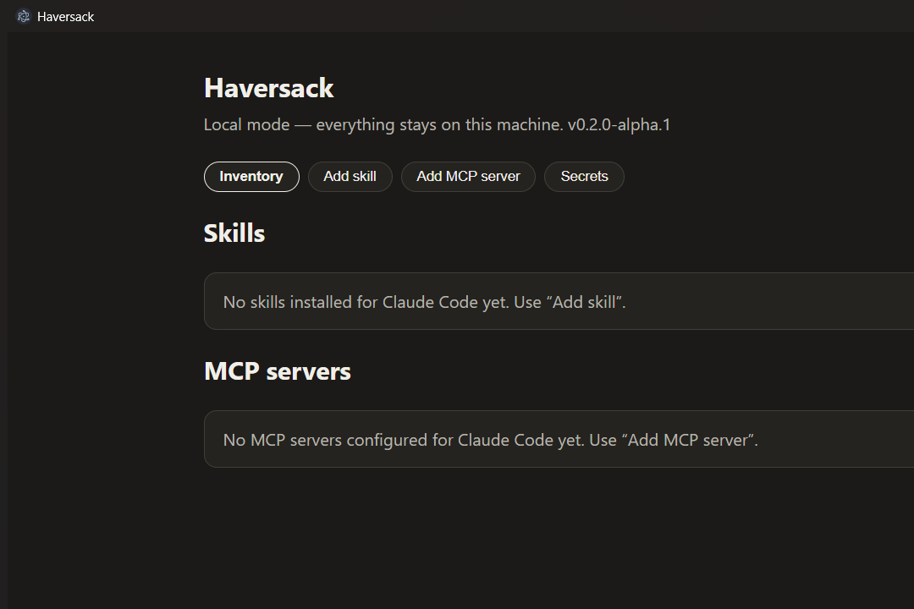
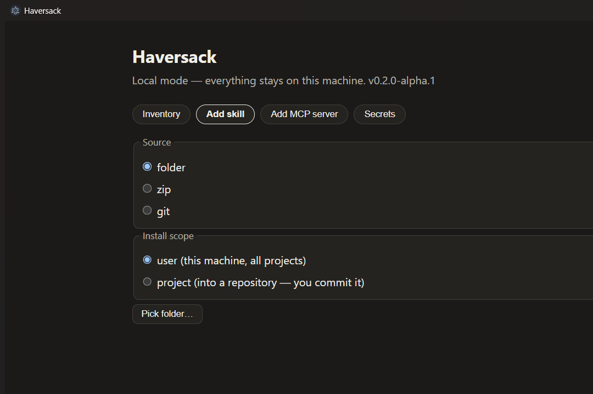
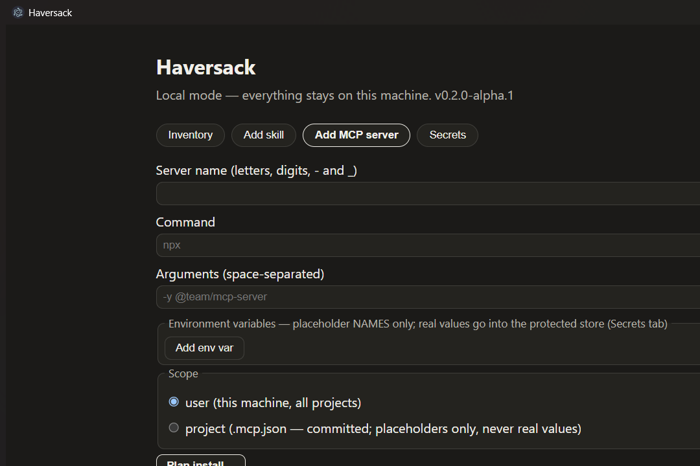
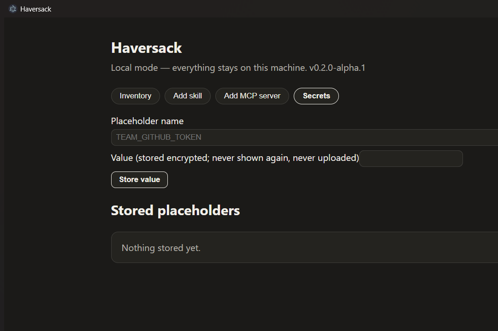

# Haversack

**Install your team's skills and MCP servers once. Everyone gets them with one click.**

> **Status: v0.2.0-alpha.1 — desktop app, local mode (prerelease).** The Windows desktop app installs skills and MCP server definitions into Claude Code on one machine, with a plan preview, undo, and an uninstall that touches only what it installed. **The team layer is not built yet:** no shared library, no accounts, no invites, no cross-machine sync (Supabase workspace ships in P4/P5 of [docs/PRD.md](docs/PRD.md)). The CLI engine from v0.1.0 is reused inside the app.

- License: MIT. The repository is **private**; file formats and exit codes may change.
- Working name: **Haversack** (trademark check pending). Code identity: `@haversackhq`, binary `haversack`.

## What exists today

### Desktop app — local mode (v0.2.0-alpha.1)

One machine, no account. Works against Claude Code (the first supported target; formats verified from official docs, [ADR 003](docs/adr/003-targets-and-install-mechanics.md)).

- **Inventory** of the skills and MCP servers already configured, marking what Haversack installed (via a content-hashed applied-items ledger) versus what you added by hand.
- **Add a skill** from a folder, a zip, or a git URL pinned to a commit. Ingestion is a security boundary: path escapes, symlinks/junctions, binary and oversized payloads are rejected; secret literals are blocked (redacted everywhere); injection-shaped content is flagged for your review.
- **Add an MCP server** (command, args, env as placeholder NAMES). Real values live in OS-protected storage (Windows DPAPI) — never in project files, never uploaded; if protected storage is unavailable the app fails closed (memory only).
- **Plan preview** showing the exact file writes (before/after sha256) and the exact `claude mcp` commands before anything happens. Changed MCP commands always require per-machine approval.
- **Apply** is per-file atomic with pre-apply snapshots. **Undo** restores the previous bytes and refuses to clobber your edits. **Uninstall** removes only what the ledger proves Haversack installed.
- **MCP connection test** that shows the exact command and asks for approval every single run.

| Inventory | Add skill | Add MCP server | Secrets |
| --- | --- | --- | --- |
|  |  |  |  |

#### Install (Windows x64)

1. Download `Haversack-Setup-<version>.exe` and the matching checksum from the [Releases page](../../releases). The repository is private, so downloading requires repo access.
2. Verify: `sha256sum Haversack-Setup-<version>.exe` (or `certutil -hashfile <file> SHA256`) against the published checksum.
3. Run the installer. It is **unsigned** — Windows SmartScreen will warn ("More info" → "Run anyway"). This is expected for the alpha; code signing is a later phase.
4. Uninstall from Windows "Installed apps" or `Uninstall Haversack.exe` in the install directory. Uninstalling removes the app **and** the app data directory (`%APPDATA%\Haversack`), including any stored secret values — verified on the dev machine.

#### Security notes

- Skill/MCP definitions from the library are data, never executed by the app. A malicious shared definition would still run on teammates' machines via the agent — publishing is admin/owner-only (team phase), every change is previewed, and changed commands never auto-apply.
- The app uses only your own OS user credentials; no service-role keys, no tokens embedded (no auto-update in the alpha — download new installers manually; see [ADR 001](docs/adr/001-desktop-architecture.md) §9).
- Architecture and hardening decisions: [ADR 001](docs/adr/001-desktop-architecture.md) (Electron, sandboxed renderer, strict CSP, utility-process isolation). Threat model: [PRD §7](docs/PRD.md).

### CLI engine (v0.1.0, unchanged product-wise)

The CLI that started this repo — `haversack init / sync / check / join` — compiles a `project.yaml` into each tool's native config, detects drift, and runs local checks. In v0.2 it is the **engine inside the desktop app**; its README-era framing (rules-as-CI product, PR enforcement) is superseded by [PRD v0.3](docs/PRD.md) — the GitHub App, PR enforcement, rules-as-CI as a product, and the MCP gateway are shelved. CLI binaries for Windows/Linux/macOS are attached to releases; `haversack --help` documents the commands.

## Not built yet (honest list)

- Team workspace: shared library, roles, invites, bundles, cross-machine apply status (P4/P5 — gated on real-team validation, PRD §12).
- Second install target (Claude Code only for now; second target chosen after validation).
- Auto-update, code signing, macOS/Linux desktop builds.
- Project binding (repo → bundle suggestions).

## Development

Node 24 + pnpm. `pnpm install`, `pnpm -r build`, `pnpm test` (core + CLI suites; the desktop app typechecks and smoke-tests — see `apps/desktop`). Docs live in `docs/`: the [PRD](docs/PRD.md) is the source of truth, [BUILD_PROGRAM](docs/BUILD_PROGRAM.md) is the phase plan, [PROGRESS](docs/PROGRESS.md) the ledger, [ADR](docs/adr) the decisions, [BUGS](docs/BUGS.md) the post-mortems.

## License

MIT — see [LICENSE](LICENSE).
