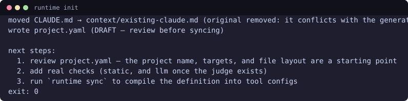
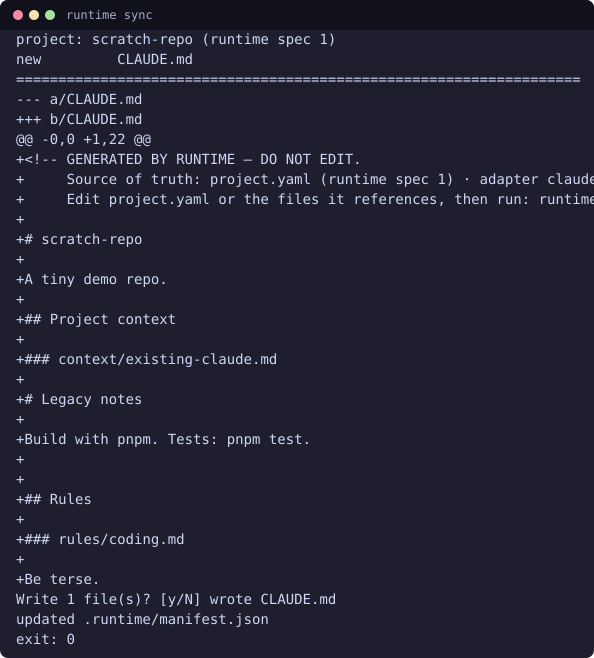
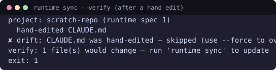
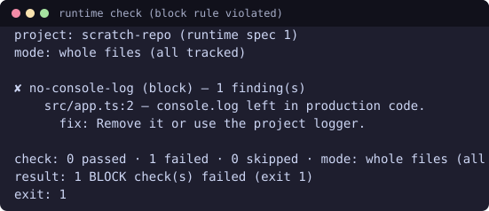
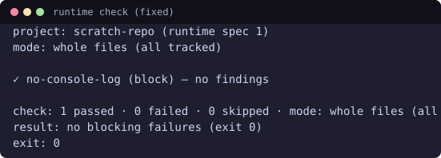
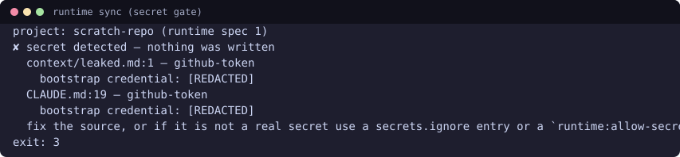
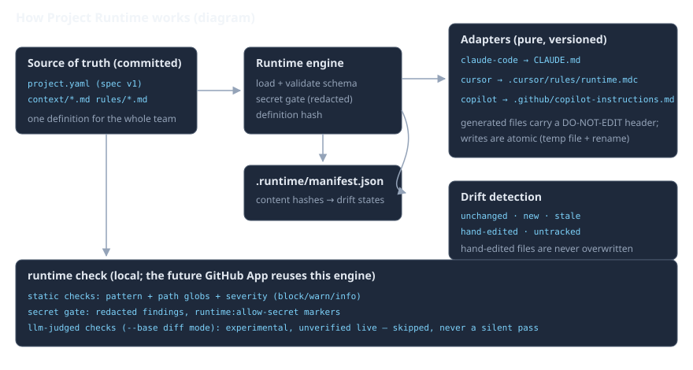

# Project Runtime

**Write your project's AI setup once. Sync it to every tool. Enforce it.**

 

> **Status: CLI release — local checks only. PR enforcement via the GitHub App is not built yet.**
> License: MIT. The repository is private during the MVP; file formats and exit codes may change before v1.

## What it is

Project Runtime is a CLI that compiles one `project.yaml` into the native config files of the AI coding tools your team already uses (Claude Code, Cursor, Copilot), detects hand-edits as drift, and runs deterministic checks on your code — locally, before you push.

Teams configure every AI tool separately: context fragments across `CLAUDE.md`, `.cursor/rules`, and Copilot instructions, drift apart, and nothing is enforced — conventions live in a file the model may half-ignore, and nobody notices until review. Runtime makes the definition a single versioned file and the enforcement a command you can run (and later, a bot) instead of a habit you have to remember.

## Demo

Real terminal output (captured from the runs documented in [docs/TESTING.md](docs/TESTING.md); regenerate the images with `node scripts/render-terminal.mjs`):

**`runtime init` — ingest an existing `CLAUDE.md`, write a DRAFT definition:**


**`runtime sync` — diff preview, confirm, write:**


**`runtime sync --verify` — a hand edit is reported as drift:**


**`runtime check` — a block-severity rule violated (exit 1):**


**fixed:**


**the secret gate — nothing is written, the value is never printed:**


## How it works



The diagram above shows the flow: `project.yaml` plus the context/rules files it references are loaded and validated, compiled by one pure adapter per target, and written atomically; a committed manifest (`.runtime/manifest.json`) tracks content hashes so hand edits are detectable; the check engine runs static rules and the secret gate locally.

## Install

Binaries are published on the [Releases page](../../releases):

| File | OS |
| --- | --- |
| `runtime-windows-x64.exe` | Windows (x64) |
| `runtime-linux-x64` | Linux (x64) |
| `runtime-macos-arm64` | macOS (Apple Silicon) |
| `runtime-macos-x64` | macOS (Intel; Apple Silicon via Rosetta) |

**These binaries are unsigned.** Windows shows a SmartScreen warning on browser downloads (see "Windows SmartScreen" below); macOS binaries are ad-hoc signed and **not notarized**, so Gatekeeper warns on first run. The repository is **private**, so downloading a release requires repo access.

1. Download the binary for your OS and `SHA256SUMS.txt`.
2. Verify the checksum:

   ```sh
   shasum -a 256 -c SHA256SUMS.txt --ignore-missing          # macOS / Linux
   Get-FileHash runtime-windows-x64.exe -Algorithm SHA256     # Windows (PowerShell)
   ```

3. Run it:

   ```sh
   runtime --version
   ```

### Windows SmartScreen

A browser download carries a Mark-of-the-Web, and SmartScreen will show **"Windows protected your PC"** for an unsigned binary. Click **More info → Run anyway**, or unblock the file first (`Unblock-File .\runtime-windows-x64.exe`, or Properties → Unblock). Files downloaded without a browser (e.g. `gh release download`) carry no Mark-of-the-Web and run without a prompt.

### Build from source

Node.js >= 20 and pnpm:

```sh
corepack enable pnpm   # or: npm i -g pnpm
pnpm install
pnpm build
pnpm test
node packages/cli/dist/main.js --version
```

## Quickstart

Exactly the flow from [docs/TESTING.md](docs/TESTING.md), run with the published binary in a scratch git repo that already has a `CLAUDE.md`:

```sh
runtime init                      # scan, ingest CLAUDE.md, write a DRAFT project.yaml
# review project.yaml, then:
printf 'y\n' | runtime sync       # diff preview + confirm → writes CLAUDE.md
runtime sync --verify             # exit 0 = everything in sync
echo "HAND EDIT" >> CLAUDE.md     # a hand edit...
runtime sync --verify             # exit 1 — drift reported
runtime sync --force --yes        # regenerate anyway
runtime check                     # run the project's checks locally
```

`runtime join` is the new-teammate flow: on a fresh clone, it syncs, verifies, and reports what is missing (measured at well under one second; the target is under 10 minutes).

## `project.yaml` reference

Every supported field, as validated by the schema (`packages/core/src/schema/project.ts`):

```yaml
runtime: 1                       # spec version (required, literal 1)
project: my-project              # kebab-case identifier (required)
description: One line, max 280 chars (optional)

context:                         # files inlined into every generated config (max 50)
  - context/product.md
  - context/architecture.md

rules:                           # instruction files, inlined after context (max 50)
  - rules/coding.md

targets:                         # at least 1 (required)
  - claude-code                  # → CLAUDE.md
  - cursor                       # → .cursor/rules/runtime.mdc
  - copilot                      # → .github/copilot-instructions.md

integrations:                    # validated but INERT in the MVP (gateway is Phase 2)
  github: { scopes: [read] }

checks:                          # max 200; ids are kebab-case and unique
  - id: no-console-log
    type: static
    severity: block              # block | warn | info (default: warn); only block fails `check`
    description: No debug output in production code.
    path: [src/**]               # glob(s) relative to the repo root (default: **)
    exclude: ["**/*.test.ts"]    # exclude wins over include
    pattern: 'console\.log\('    # JavaScript regex, max 500 chars; single-quote in YAML
    flags: [i]                   # i, m, s, u
    message: console.log left in production code.
    fix: Remove it or use the project logger.

  - id: rls-on-new-tables
    type: llm                    # EXPERIMENTAL — unverified live; skipped without config,
    severity: warn               # never a silent pass (see "Checks")
    paths: [supabase/migrations/**]   # only changed files matching these reach the judge
    prompt: |
      Every new SQL table must enable row-level security.

model_policy:
  pin: true                      # record the model version used per run
  # model: gpt-4o-mini           # judge model — from config, never hardcoded
  # budget:                      # USD (2 decimals); exhaustion → skipped, never a pass
  #   usd_per_run: 0.50
  #   usd_per_month: 10.00
  #   usd_per_1m_input: 0.15     # prices used to compute USD from tokens
  #   usd_per_1m_output: 0.60

secrets:
  ignore:                        # repo-wide allowlist (findings stay redacted)
    - pattern: 'EXAMPLE_KEY'
      reason: documented example value
```

## Checks

**Static checks** (deterministic, always run): per-line regex over files
matching `path` globs (minus `exclude`), with severities `block`, `warn`,
`info`. Only `block` failures make `runtime check` exit non-zero. Whole-file
mode is the default; `--base <ref>` restricts evaluation to the added lines of
`git diff <ref>`. A check with no files in scope reports `skipped` — never a
vacuous pass. A check that exceeds its cooperative time budget (1 s) is
`skipped` with a reason — never a hang, never a pass.

**LLM-judged checks** are **experimental and unverified live**: they run only
in `--base` diff mode, only on changed files matching `paths`, require
`OPENAI_API_KEY` (environment only, never logged), `model_policy.model`, and
budget prices. Every failure mode — unparseable verdict, timeout after
bounded retries, rate limits, exhausted budget — yields `skipped` with a
reason, never a pass.

**Exit codes** (PRD decision D6):

| Code | Meaning |
| --- | --- |
| 0 | success / clean |
| 1 | changes or drift detected (`sync --verify`), or a block-severity check failed (`check`) |
| 2 | configuration error (bad yaml, unknown target, unsafe path, …) |
| 3 | secret detected (findings redacted) |

Note: `--base` evaluates your local diff only. Evaluating a pull request's
**base branch** definition against the PR is the GitHub App's job — it is not
built yet, so no PR is gated today.

## Drift detection and the manifest

Every generated file is written with a `GENERATED BY RUNTIME — DO NOT EDIT`
header, and its normalized content hash is recorded in
`.runtime/manifest.json` (committed to git). On every later `sync`, Runtime
compares the file it would generate against the file on disk and the manifest:

- `unchanged` — nothing to do
- `new` — file does not exist yet
- `stale` — matches the last sync but the definition moved on → rewrite
- `hand-edited` — differs from the last sync → reported, never overwritten
  without `--force`
- `untracked` — not Runtime's file → never touched without `--force`

This is why a hand edit shows up as `hand-edited` drift in the demo above, and
why `sync --verify` (exit 0/1) is safe to run in CI.

## Security model

- **Secret gate**: `sync` and `check` scan the definition, referenced files,
  and generated output for credential shapes (AWS keys, GitHub tokens, Stripe
  keys, generic `password = …` assignments). Findings block the run (exit 3)
  and are always **redacted** — the value never reaches any output.
  Allowlisting: a `runtime:allow-secret` line marker or a `secrets.ignore`
  list in `project.yaml`.
- **No secrets in generated files**: the gate runs on generated output before
  anything is written.
- **Repo content is untrusted**: paths in `project.yaml` cannot escape the
  repo (`..`, absolute paths, backslashes, drive letters, and symlinks that
  resolve outside the root are rejected); LLM judge input is delimited as
  untrusted data with instructions ignored; the judge has no tool access.
- **Atomic writes**: generated files and the manifest are written via a temp
  file + rename, so a crash cannot leave a half-written target.
- Generated files are marked as generated; hand edits are detected as drift.

## Supported targets

Verified against official documentation (`docs/agents-md-findings.md`):

| Target | Output | Source |
| --- | --- | --- |
| `claude-code` | `CLAUDE.md` | [Claude Code docs](https://code.claude.com/docs/en/memory) |
| `cursor` | `.cursor/rules/runtime.mdc` | [Cursor docs](https://cursor.com/docs/context/rules) |
| `copilot` | `.github/copilot-instructions.md` | [GitHub docs](https://docs.github.com/en/copilot/customizing-copilot/adding-repository-custom-instructions-for-github-copilot) |

Anything else is **planned**, not built: an `agents-md` target (for tools that
read `AGENTS.md` natively — research and proposal in
`docs/agents-md-findings.md`) and further targets are on the roadmap.

## Not included yet

Stated plainly — none of this exists today:

- **GitHub App / PR enforcement** — designed (`docs/github-app-design.md`),
  not built. `runtime check` is local-only; no PR is gated.
- **Dashboard** (members, integrations status, check results, drift report)
- **Managed MCP gateway** (Phase 2; `integrations:` validates but is inert)
- **Skills** and **living context** (PRD F7, F3)
- **AST-based static checks** (pattern checks only today)
- **Import mode** for large generated files (v1.1; files over ~20 KB warn at
  sync time)

## FAQ

**How is this different from just an `AGENTS.md` or `CLAUDE.md` file?**
Those files are per-tool, hand-maintained, and drift apart the moment someone
edits one and forgets the others. Runtime keeps one definition and compiles
all of them, marks its outputs as generated, detects hand edits as drift, and
enforces rules with `runtime check` — a shared file enforces nothing.

**Does it send my code anywhere?** No. `sync`, `check`, and static checks are
fully local. The only network call in the product is the optional
experimental LLM judge, and only when you configure it (a diff snippet of
changed lines is sent to the configured model; the key comes from your
environment).

**Does it block pull requests?** Not yet — that needs the GitHub App
(designed, not built). Today `runtime check` is a local pre-push gate you can
wire into your own CI.

**Why is my generated file overwritten when I run `sync --force`?** Because
you told it to — without `--force`, hand-edited files are never touched.

## Contributing

See [CONTRIBUTING.md](CONTRIBUTING.md) (small commits, tests per change, the
bug policy: failing regression test first → root cause → guard →
`docs/BUGS.md`).

## Security reporting

See [SECURITY.md](SECURITY.md) for how to report vulnerabilities privately.

## License

[MIT](LICENSE) for `packages/cli` and `packages/core`. The hosted GitHub App
and the managed gateway will carry the commercial layer (PRD decision D12).
